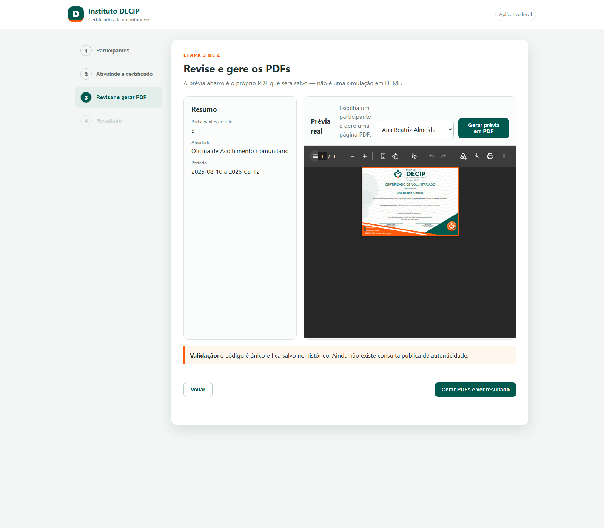
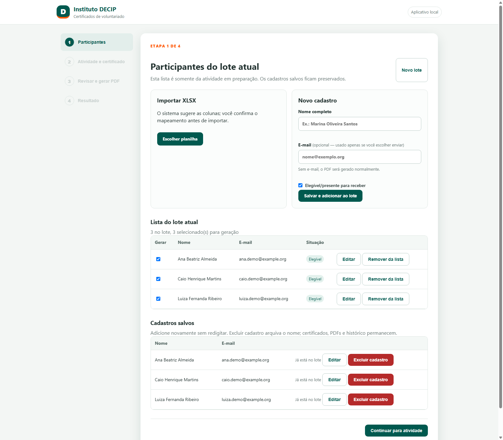
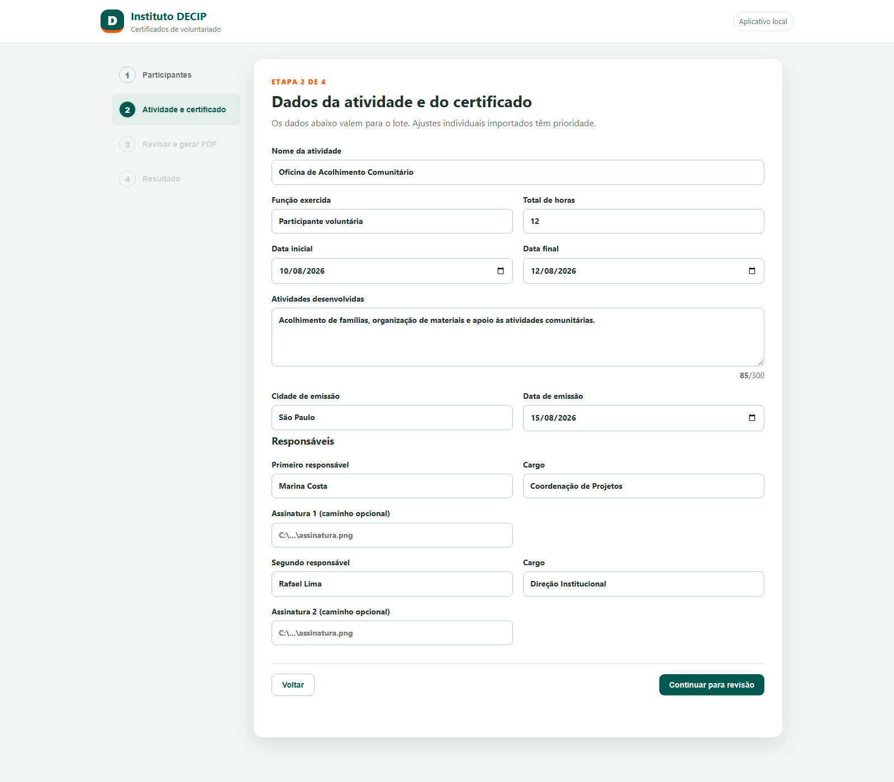
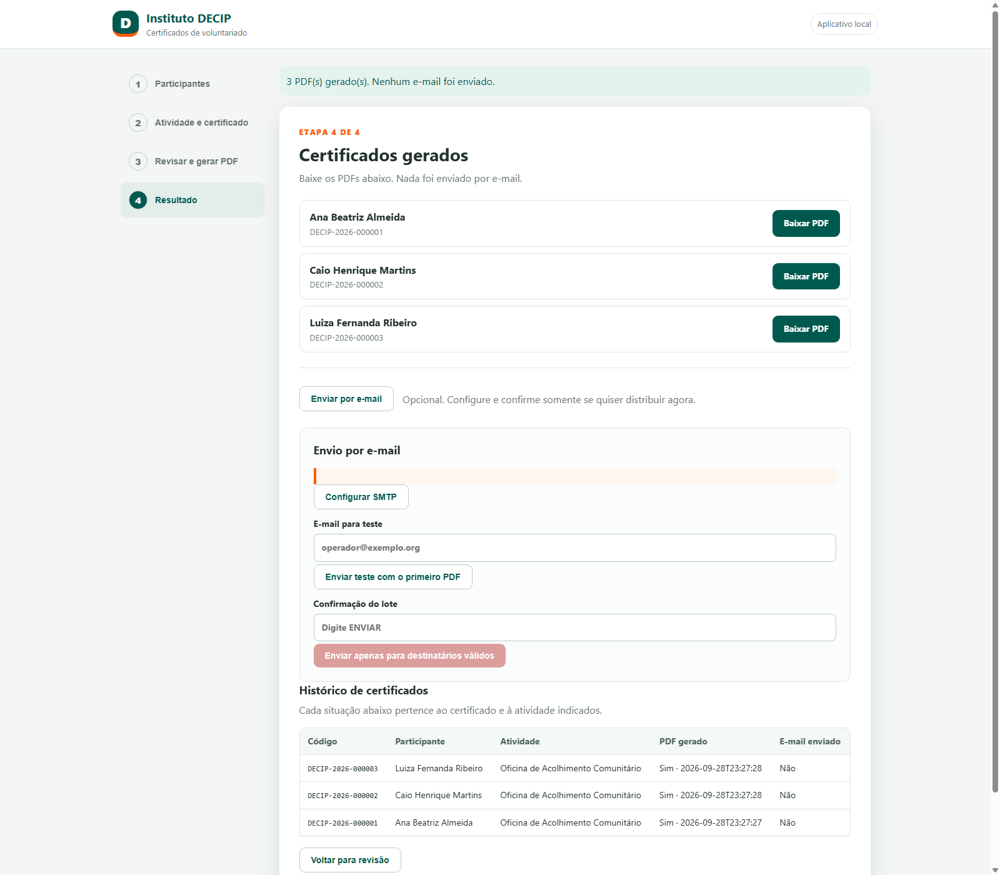

# Certificados DECIP

O Instituto DECIP promove ações e atividades voluntárias que merecem ser
registradas. Este aplicativo ajuda a equipe a organizar participantes, preparar
certificados em PDF e, quando desejar, enviar cada arquivo por e-mail.



*Prévia real de um certificado de demonstração; participante e atividade são fictícios.*

## Instalação no Windows

1. No GitHub, abra **Code → Download ZIP** e extraia o arquivo em uma pasta do
   computador.
2. Confira os pré-requisitos: Windows, Python 3.12 instalado com o iniciador
   `py` disponível e conexão com a internet para baixar as dependências.
3. Na pasta extraída, execute `instalar.bat` e aguarde a conclusão.
4. Execute `iniciar.bat`. Ele inicia o servidor local e abre o navegador.
5. Se o navegador não abrir automaticamente, acesse
   <http://127.0.0.1:8765>.

Os scripts reais usam `py -3.12` para criar o ambiente virtual, instalam os
pacotes de `requirements.txt` e iniciam `run.py` em `127.0.0.1:8765`. A
instalação em uma máquina limpa ainda não foi validada; esses passos descrevem o
que os scripts executam e os pré-requisitos que eles esperam.

Para encerrar, pressione `Ctrl+C` na janela do servidor.

## Uso

Importe uma planilha XLSX ou cadastre pessoas, monte o lote, preencha os dados da
atividade, confira a prévia e gere os PDFs. O envio é opcional e separado da
geração: nenhum e-mail é enviado ao criar os certificados.

<details>
<summary>Ver as telas da demonstração</summary>

**Participantes fictícios no lote**



**Dados da atividade de demonstração**



**Resultado, downloads e opções de envio**



</details>

## Dados e privacidade

Cadastros, lotes, atividade e histórico ficam no banco local `data/decip.db`.
Os PDFs são gravados em `output/`. Faça cópias de segurança dessas pastas de
acordo com as regras da instituição: os registros podem conter dados pessoais.
A senha SMTP fica no Gerenciador de Credenciais do Windows, por meio de
`keyring`.

O aplicativo escuta somente em `127.0.0.1`. Ainda não há consulta pública de
autenticidade dos certificados. O projeto não foi declarado livre de falhas;
consulte [o status e as limitações](docs/STATUS.md) antes do uso institucional.

## Testes

```bat
.venv\Scripts\python.exe -m unittest discover -v
```

Os testes automatizados usam bancos e dados fictícios. Os testes de e-mail não
fazem envios reais.

## Créditos e licenças

Esta é uma implementação própria para o Instituto DECIP. O projeto de referência
estudado e os avisos de licença de terceiros estão descritos em
[THIRD_PARTY_NOTICES.md](THIRD_PARTY_NOTICES.md).
